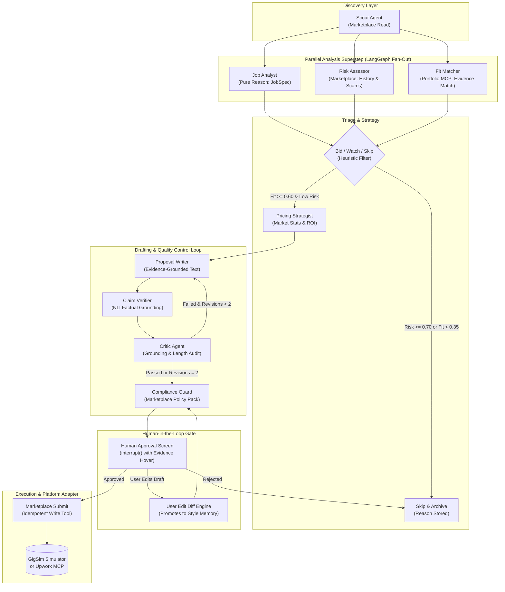

# GigBid System Architecture

## 1. Architectural Philosophy: Durable Multi-Agent Orchestration
GigBid is designed as a production-grade multi-agent copilot for technical freelancers on competitive online platforms (Upwork and GigSim). Rather than relying on a monolithic prompt or an unbounded autonomous loop, GigBid enforces strict role separation, hand-written LangGraph state machines, bounded critique iterations, explicit memory promotion rules, and a mandatory human approval gate before any action that spends Connects or sends messages.

---

## 2. Multi-Agent Topography

---

## 3. Why Each Agent Exists

| Agent Role | Primary Responsibility | Authorized MCP Access | Justification & Rationale |
| :--- | :--- | :--- | :--- |
| **1. Scout** | Saved searches, queue polling, and deduplication | `search_jobs`, `get_job` | Isolates ingestion polling from downstream reasoning. Deduplicates previously seen posts to conserve token budgets. |
| **2. Job Analyst** | Extracts structured `JobSpec` (deliverables, skills, budget, questions) | *None (Pure Reasoning)* | Treating untrusted job posts as untrusted input requires a sandboxed parser with zero external tool capabilities, preventing injection escalation. |
| **3. Risk Assessor** | Evaluates client rating, payment verification, unpaid trials, scams | `get_client_history`, `get_job` | Evaluates platform risk before proposal drafting. Immediately flags scam posts, saving Connects and agent compute. |
| **4. Fit Matcher** | Compares requirements to portfolio evidence, outputs `FitReport` | `search_evidence`, `get_case_study`, `list_skills` | Grounding anchor: guarantees that skills marked as "matched" are backed by real, verified portfolio assets. Runs in parallel with Analyst and Risk Assessor. |
| **5. Pricing Strategist** | Computes bid proposal, connects ROI, and evaluates user floor | `get_client_history`, `get_connects_balance` | Decouples pricing strategy from proposal writing. Incorporates historical win rates and market distributions. |
| **6. Proposal Writer** | Drafts personalized cover letters citing explicit evidence IDs | `search_evidence`, `get_case_study` | Focuses purely on persuasive, evidence-backed proposal drafting. Strictly prohibited from using generic clichés. |
| **7. Claim Verifier** | Splits proposal into atomic claims and verifies against evidence | `search_evidence`, `get_case_study` | Essential truth filter: checks NLI support for every sentence. Strips unsupported assertions before the Critic audits the draft. |
| **8. Critic** | Audits grounding, personalization, word count; max 2 revisions | `search_evidence`, `get_case_study` | Quality gatekeeper that forces revisions on weak drafts. Bounded at 2 revisions to eliminate infinite loop risk. |
| **9. Compliance Guard** | Enforces platform policies: removes contact details, guarantees, injections | *None (Policy Guard)* | Sandboxed platform rules enforcer. Guarantees that no off-platform contact details (emails, WhatsApp, Telegram) ever reach the marketplace. |
| **10. Client Liaison** | Classifies client reply intent and drafts responses/calendar holds | `list_messages`, `send_message`, `get_calendar_availability`, `create_interview_hold` | Operates the Conversation Graph. Manages client interview requests, proposing real free slots from Workspace MCP. |

---

## 4. State Discipline: The Three-Tier Separation

GigBid strictly separates three operational data layers:
1. **Thread State (`GigBidState` / `ConversationState`)**:  
   Contains only the ephemeral data needed for the current job or conversation thread (JobSpec, FitReport, ProposalDraft, interrupt status). Managed through typed Pydantic models with reducers (`Annotated[..., operator.add]`) for parallel fan-in.
2. **Execution Trace (`execution_trace`)**:  
   An append-only log capturing every node transition, tool call, input arguments, raw observations, and sub-millisecond latencies for auditability and grading.
3. **Long-Term Memory (`LongTermMemoryStore`)**:  
   Persistent memory stored across runs, accessible via explicit promotion rules only:
   - **Style Memory**: Learned preferences derived from human edit diffs (e.g. "Never use 'passionate'", "Cut introductory greetings").
   - **Outcome Memory**: Category-specific empirical performance metrics (win rates, top-converting evidence IDs). Raw tool outputs never enter long-term memory.

---

## 5. Durability & Crash Recovery
- Built with a durable checkpointer (`MemorySaver` / Postgres Checkpointer).
- Demonstrates crash-and-resume resilience: killing the API server while a proposal sits at the human approval gate resumes seamlessly upon restart without duplicate submissions or lost state.
